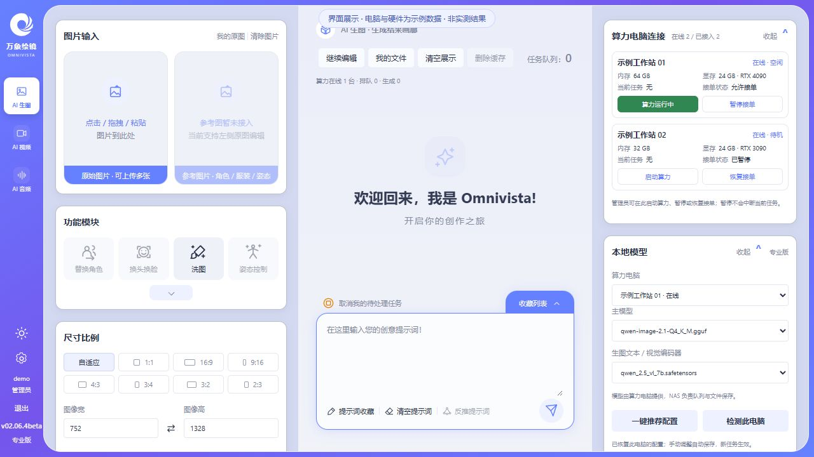
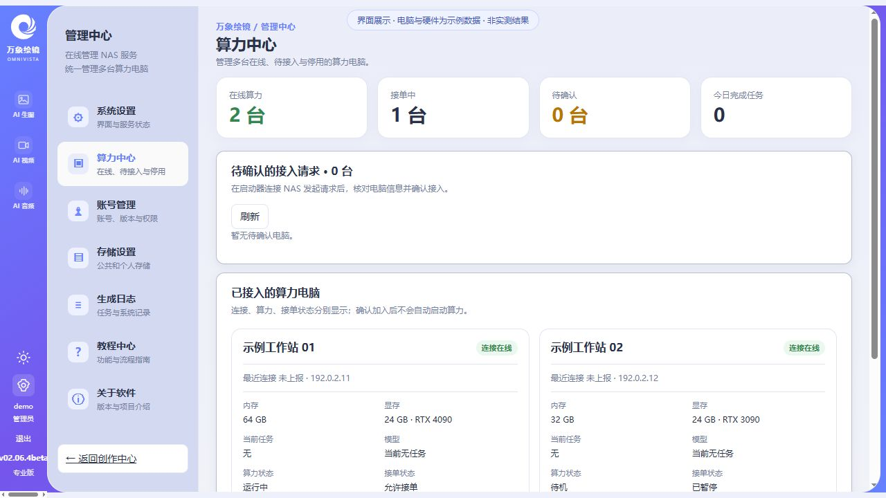
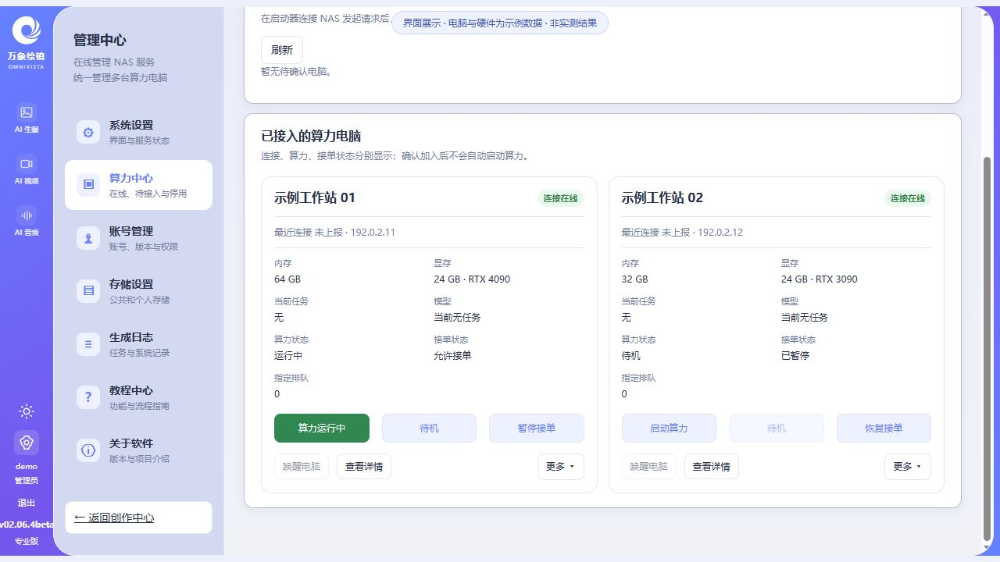
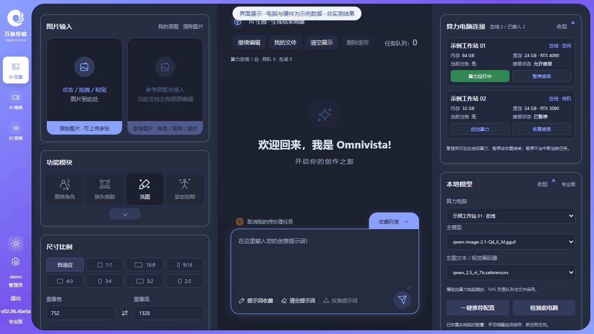
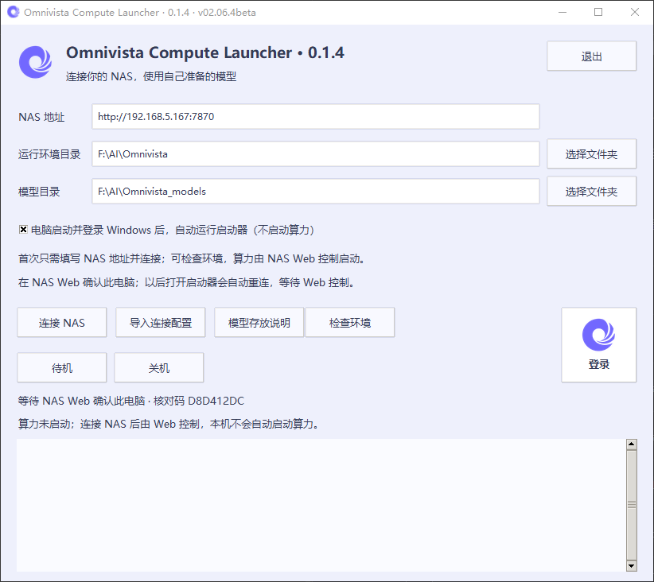

# Omnivista · 万象绘镜

NAS 本地 AI 创作与多算力管理平台。

Omnivista（万象绘镜）把 NAS 和多台 Windows 算力电脑连接起来，提供统一的网页创作入口。NAS 负责账号、任务队列、图片存储和生成日志；各台电脑运行自己的 ComfyUI、加载本地模型并执行任务。可以从浏览器集中查看电脑状态、管理接单，并查看和下载生成结果。

## 项目介绍

- **一台 NAS，管理多台算力电脑**：每台电脑独立显示连接、算力和接单状态，首页也能快速启动算力、暂停或恢复接单。
- **本地 AI 创作**：目前提供文生图和原图编辑流程，支持提示词、图片尺寸、采样参数、队列与生成结果管理。
- **逐台模型配置**：查看电脑上报的硬件和已安装模型，按电脑选择模型与编码器，保存各自的配置。
- **集中控制**：Web 端确认电脑接入，并提供启动算力、待机、暂停接单、网络唤醒和关机入口；唤醒需要对应的网络、BIOS 和网卡设置。
- **统一工作空间**：创作、算力中心、账号、存储、日志和教程共用导航，支持亮色/深色主题与可折叠卡片。

多算力是多台电脑分别处理分配到的任务，不是将多张显卡合并执行同一次推理。AI 视频、AI 音频以及界面中标注“待接入”的功能仍在开发，不能视为已经可用。

本仓库仅提供安装包、版本说明与使用指引，不包含项目源码。Windows 完整算力端包含启动器、Python、PyTorch/CUDA 运行库、ComfyUI、必要插件和工作流；模型与 Windows GPU 驱动需自行准备。

## 界面展示

以下使用当前 v02.06.4beta 界面截取，电脑、账号、地址与硬件均为演示数据；不是实际设备运行记录、性能测试或生图验收结果。模型名称仅作界面示例，安装包不附带模型。

### 创作首页 · 多电脑快捷状态

### 算力中心 · 状态总览

### 多台电脑 · 独立控制

### 深色主题

## 交流与反馈

**QQ 交流群：934220040**

欢迎交流安装使用、反馈问题和提出建议。反馈时请附上版本号、问题描述及相关截图，注意遮挡个人信息。

## 下载

进入右侧 **Releases**，选择 **v02.06.4beta**，展开 **Assets**：

- `omnivista-v02.06.4beta-linux-amd64.tar`：NAS Docker 镜像，适用于 x86-64 NAS。
- `OmnivistaCompute-Full-0.1.4-v02.06.4beta.7z.001`～`.004`：Windows 完整算力端，共 4 卷、约 6.34 GiB；须全部下载。解压后运行环境约 15.6 GiB，另备模型空间。
- `SHA256SUMS`：安装包 SHA256 校验值。

启动器独立版本仍为 **0.1.4**，窗口同时标明兼容 **v02.06.4beta**。本次为同版本覆盖更新，完整分卷包替代旧的仅启动器 ZIP；请重新下载，不要混用旧附件。

## NAS 安装与升级

1. 下载 TAR，在 NAS 容器管理器中导入，也可使用 `docker load --input omnivista-v02.06.4beta-linux-amd64.tar`。
2. 镜像标签为 `ghcr.io/xiaoshuo6019/omnivista:v02.06.4beta`，服务端口为 `7870`。
3. 已安装用户先备份数据，沿用原有数据目录、图片目录及端口配置，再用新镜像重新创建容器；不要删除原数据卷。
4. 首次安装用户需给容器配置可写的 `/data` 持久化挂载，再访问 `http://NAS地址:7870/` 完成页面上的初始化。

下载或导入镜像不会自动替换已有运行容器。仅调整镜像版本，不把容器临时文件系统当作持久化存储。

## Windows 启动器

启动器界面由用户提供。NAS 地址、运行环境与模型目录请按自己的设备填写；首次连接由 NAS Web 确认接入。

1. 下载全部同名 `.7z.001`、`.7z.002` 等分卷到同一目录，用 7-Zip 打开 `.001` 完整解压到可写目录。不要逐卷解压，也不要只取出 EXE。尽量使用较短路径，如 `D:\OmnivistaCompute`；运行库包含长路径文件。
2. 保持 `Omnivista` 与 `Omnivista_models` 两个文件夹同级。双击 `Omnivista/Omnivista Compute Launcher.exe`；运行环境选 `Omnivista`，模型选同级 `Omnivista_models` 或自己的已有模型目录。模型按启动器“模型存放说明”放入 `unet`、`text_encoders`、`vae`、`loras`。
3. 升级前先完全退出旧启动器并备份配置。保留自己的模型与 `private`，不要用新包的空目录覆盖；新电脑不要复制别人的 NAS 连接身份。Windows GPU 驱动仍需自行安装。
4. 首次填写 NAS 地址，点击“连接 NAS”，由 NAS Web 管理员确认接入；以后自动读取配置并重连。
5. Windows 登录后自动运行的是启动器，不会自动启动算力。算力由 NAS Web 控制，本机保留待机和关机。
6. 右侧白底正方形按钮上方为图标、下方为“登录”，用于打开 NAS 网页。
7. 连接后按 NAS 请求只读上报硬件与实际模型清单；不自动下载或加载模型。

不要分享自己的 private、cache、logs 目录，只分享原始下载包。

### 基础生图模型表

- [Qwen-Image 2.1 模型介绍与本地下载放置指引](docs/models/qwen-image-2.1.md)

程序和模型保持分开，启动器的模型目录选择 `Omnivista_models` 根目录，不要选择某一个文件或 `unet` 子目录。完整运行环境包内附有“模型清单与路径.md”，权重需要自行准备。

| 文件 | 约大小 | 模型目录下的位置 | 用途 |
|---|---:|---|---|
| `qwen-image-2.1-UC-Q4_0.gguf` | 3.87 GiB | `unet/` | 主模型 |
| `qwen3vl_8b_w4a8_heretic.safetensors` | 5.88 GiB | `text_encoders/` | 编码器 |
| `qwen_image_2.1_vae_bf16.safetensors` | 0.63 GiB | `vae/` | VAE |
| `Qwen-Image-2.1-viggle-turbo-4step-lora-r64.safetensors` | 0.32 GiB | `loras/` | 文生图 LoRA |
| `elusarcas-qwen2-1-detailer-v1.safetensors` | 0.07 GiB | `loras/` | 文生图细节 LoRA |
| `Qwen-Image-2.1-viggle-turbo-v0.2.1-6step-lora-r128.safetensors` | 0.63 GiB | `loras/` | 图片编辑 LoRA |

当前这组共约 11.40 GiB，只对应已接通的基础文生图和图片编辑，不是 v01 全部功能资源。已有模型可继续放在其他磁盘，启动器选择其共同根目录即可；无需修改 NAS 或 ComfyUI 服务地址。

## 版本范围

本版更新多算力卡片、统一导航、接入确认、远程控制、硬件上报和逐台模型配置。网络唤醒依赖 NAS 网络、BIOS 与网卡，Docker bridge 下的广播是否可达需要实际确认。

账号、存储和真实生成日志统一在管理中心操作。旧管理页面已移除，教程也已更新为当前操作路径，不再跳转旧界面或要求运行旧 BAT。

这是 beta 版本。CI 检查服务与 Linux 容器启动；真实 GPU 生图、关机、唤醒与具体用户环境仍需自行验证。请在升级前做好备份。
