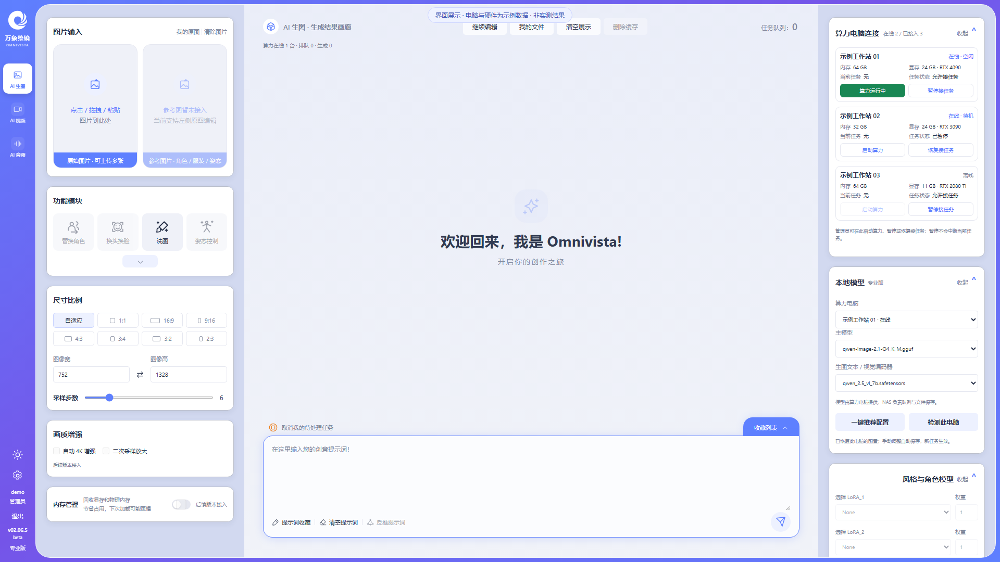
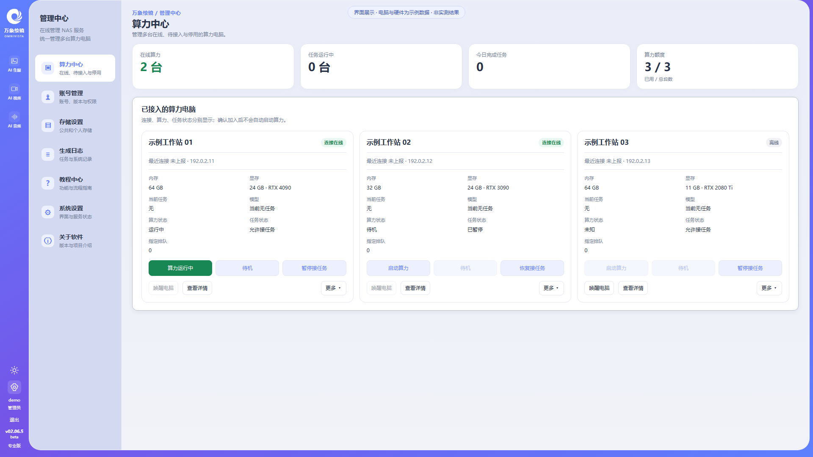
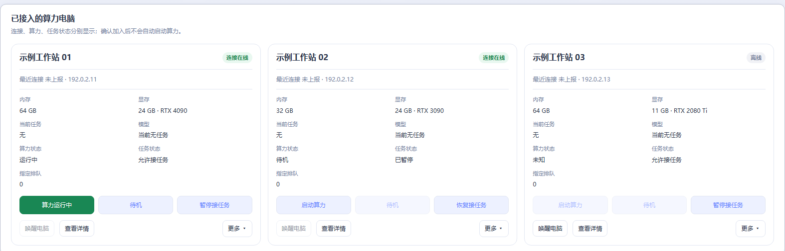
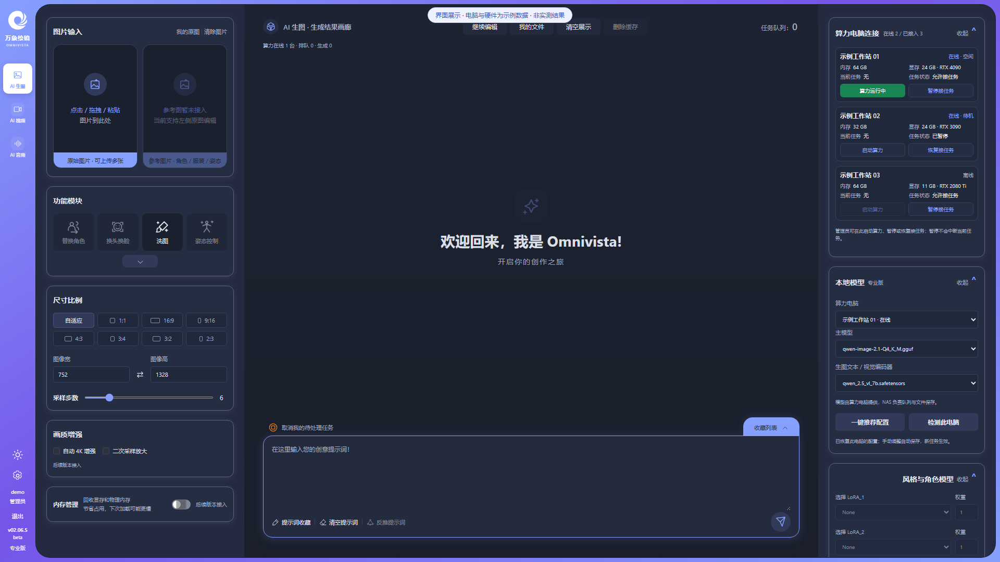
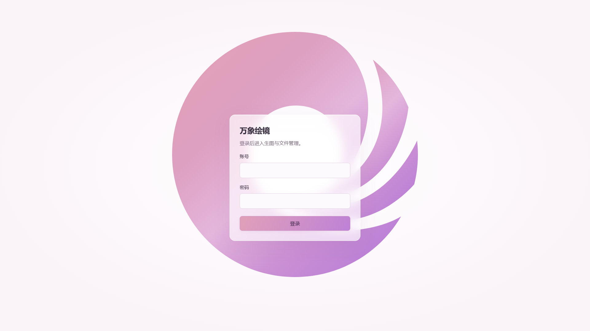

# Omnivista · 万象绘镜

NAS 本地 AI 创作与多算力管理平台。

Omnivista（万象绘镜）把 NAS 和多台 Windows 算力电脑连接起来，提供统一的网页创作入口。NAS 负责账号、任务队列、图片存储和生成日志；各台电脑运行自己的 ComfyUI、加载本地模型并执行任务。可以从浏览器集中查看电脑状态、管理任务接收，并查看和下载生成结果。

## 项目介绍

- **一台 NAS，管理多台算力电脑**：每台电脑独立显示连接、算力和任务状态，首页也能快速启动算力、暂停或恢复接任务。
- **本地 AI 创作**：提供文生图、图片编辑、替换角色、换头换脸、洗图、姿态控制、扩图与图片反推，支持参考图、LoRA、画质增强、采样参数、队列与生成结果管理；功能按电脑实际安装的模型与工作流开放。
- **逐台模型配置**：查看电脑上报的硬件和已安装模型，按电脑选择模型与编码器，保存各自的配置。
- **集中控制**：Web 端确认电脑接入，并提供启动算力、待机、暂停接任务、网络唤醒和关机入口；唤醒需要对应的网络、BIOS 和网卡设置。
- **统一工作空间**：创作、算力中心、账号、存储、日志和教程共用导航，支持亮色/深色主题与可折叠卡片。

多算力是多台电脑分别处理分配到的任务，不是将多张显卡合并执行同一次推理。AI 视频、AI 音频以及界面中标注“待接入”的功能仍在开发，不能视为已经可用。

本仓库仅提供安装包、版本说明与使用指引，不包含项目源码。Windows 完整算力端包含启动器、Python、PyTorch/CUDA 运行库、ComfyUI、必要插件和工作流；模型与 Windows GPU 驱动需自行准备。

## 界面展示

以下为历史 v02.06.5beta Web 界面展示（8beta+ 沿用整体风格），电脑、账号、地址与硬件均为演示数据；不是实际设备运行记录、性能测试或生图验收结果。模型名称仅作界面示例，安装包不附带模型。

### 创作首页 · 多电脑快捷状态

### 算力中心 · 状态总览

### 多台电脑 · 独立控制

### 深色主题

### 登录页 · 粉紫渐变与半透明卡片

## 交流与反馈

**QQ 交流群：934220040**

欢迎交流安装使用、反馈问题和提出建议。反馈时请附上版本号、问题描述及相关截图，注意遮挡个人信息。

## 使用与模型许可说明

本项目目前免费提供，仅供学习交流及本地 AI 技术研究与评估，发行包不包含模型权重。

第三方模型、插件及运行组件分别遵循各自许可证，本项目不授予其额外使用权。

当前推荐的 Qwen-Image 2.1 受 Qwen Research License 约束，仅限研究或评估用途；商业用途须另行取得模型权利人的许可。请在下载及使用前阅读对应许可证。

- [Qwen-Image 2.1 官方许可证（Qwen Research License）](https://huggingface.co/Qwen/Qwen-Image-2.1/blob/main/LICENSE)

## 下载

进入右侧 **Releases**，选择 **v02.06.8beta-plus**，展开 **Assets**：

- `omnivista-v02.06.8beta-plus-linux-amd64.tar`：NAS Docker 镜像，适用于 x86-64 NAS。
- `Omnivista-path-0.1.9-native.zip`：启动器更新补丁，适合已经安装完整环境的电脑，不包含 Python、ComfyUI、CUDA 或模型。
- Windows 完整基础环境（base）放在 [8beta+ 下载页](https://github.com/xiaoshuo6019/Omnivista/releases/tag/v02.06.8beta-plus)，文件为 `Omnivista-base-0.1.4.7z.001`～`.004`：共 4 卷、约 6.34 GiB，首次安装须全部下载。解压后运行环境约 15.6 GiB，另备模型空间；此基础环境可配合 8beta+ 使用。
- `SHA256SUMS`：NAS 安装包 SHA256 校验值；`SHA256SUMS-launcher`：启动器补丁校验值。

8beta+ 更新补丁除 EXE 外包含七个工作流；升级时先备份同名文件，再复制到原 workflows 目录，保留其他文件。NAS 与启动器须配套更新，建议先更新 NAS。

**首次安装：base 完整四卷 → 解压 → 安装最新 path 补丁；已有完整环境：只下载最新 path 补丁。** `base` 是完整基础环境，`path` 是后续更新包（按项目命名）。补丁文件名只带启动器独立版本号；0.1.9 兼容 NAS v02.06.8beta-plus。不要把小补丁当成完整运行环境。

## NAS 安装与升级

1. 下载 TAR，在 NAS 容器管理器中导入，也可使用 `docker load --input omnivista-v02.06.8beta-plus-linux-amd64.tar`。
2. 镜像标签为 `omnivista-native:v02.06.8beta-plus`，服务端口为 `7870`。
3. 已安装用户先备份数据，沿用原有数据目录、图片目录及端口配置，再用新镜像重新创建容器；不要删除原数据卷。
4. 首次安装用户需给容器配置可写的 `/data` 持久化挂载，再访问 `http://NAS地址:7870/` 完成页面上的初始化。

下载或导入镜像不会自动替换已有运行容器。仅调整镜像版本，不把容器临时文件系统当作持久化存储。

## Windows 启动器

上图为用户提供的历史布局参考；当前 0.1.9 保留 NAS 连接状态，接通七个生图工作流、图片反推和缓存清理，保留真实采样进度上报，EXE 文件名、窗口和 Windows 文件属性均显示独立版本 0.1.9。NAS 地址、运行环境与模型目录请按自己的设备填写；首次连接由 NAS Web 确认接入。

1. 下载全部同名 `.7z.001`、`.7z.002` 等分卷到同一目录，用 7-Zip 打开 `.001` 完整解压到可写目录。不要逐卷解压，也不要只取出 EXE。尽量使用较短路径，如 `D:\OmnivistaCompute`；运行库包含长路径文件。
2. 保持 `Omnivista` 与 `Omnivista_models` 两个文件夹同级。安装最新 path 后双击 `Omnivista/Omnivista Compute Launcher 0.1.9.exe`；运行环境选 `Omnivista`，模型选同级 `Omnivista_models` 或自己的已有模型目录。模型按启动器“模型存放说明”放入 `unet`、`text_encoders`、`vae`、`loras`。
3. 首次安装解压 base 后，或已有完整环境升级时，先完全退出旧启动器（含托盘）并备份配置；从最新 `Omnivista-path-0.1.9-native.zip` 解压出 `Omnivista Compute Launcher 0.1.9.exe` 放入原 `Omnivista` 目录，将旧 EXE 移到备份目录，避免误开旧版；桌面快捷方式改为新文件。首次手动打开后点击“连接 NAS”保存原配置，以登记当前文件名的登录自启动。只替换启动器，保留 `app`、`runtime`、`workflows`、模型与 `private`；新电脑不要复制别人的 NAS 连接身份。Windows GPU 驱动仍需自行安装。
4. 首次填写 NAS 地址，点击“连接 NAS”，由 NAS Web 管理员确认接入；以后自动读取配置并重连。
5. Windows 登录后自动运行的是启动器，不会自动启动算力。算力由 NAS Web 控制，本机保留待机和关机。
6. 右侧白底正方形按钮上方为图标、下方为“登录”，用于打开 NAS 网页。
7. 连接后按 NAS 请求只读上报硬件与实际模型清单；不自动下载或加载模型。

不要分享自己的 private、cache、logs 目录，只分享原始下载包。

### 基础生图模型表

- [Qwen-Image 2.1 模型介绍与本地下载放置指引](docs/models/qwen-image-2.1.md)

程序和模型保持分开，启动器的模型目录选择 `Omnivista_models` 根目录，不要选择某一个文件或 `unet` 子目录。完整运行环境包内附有“模型清单与路径.md”，权重需要自行准备。

| 文件 | 约大小 | 模型目录下的位置 | 用途 |
|---|---:|---|---|
| `qwen-image-2.1-UC-Q4_0.gguf` | 3.87 GiB | `unet/` | 主模型 |
| `qwen3vl_8b_w4a8_heretic.safetensors` | 5.88 GiB | `text_encoders/` | 编码器 |
| `qwen_image_2.1_vae_bf16.safetensors` | 0.63 GiB | `vae/` | VAE |
| `Qwen-Image-2.1-viggle-turbo-4step-lora-r64.safetensors` | 0.32 GiB | `loras/` | 文生图 LoRA |
| `elusarcas-qwen2-1-detailer-v1.safetensors` | 0.07 GiB | `loras/` | 文生图细节 LoRA |
| `Qwen-Image-2.1-viggle-turbo-v0.2.1-6step-lora-r128.safetensors` | 0.63 GiB | `loras/` | 图片编辑 LoRA |

当前这组共约 11.40 GiB，只对应已接通的基础文生图和图片编辑，不是 v01 全部功能资源。已有模型可继续放在其他磁盘，启动器选择其共同根目录即可；无需修改 NAS 或 ComfyUI 服务地址。

## 版本范围

8beta+ 接通替换角色、换头换脸、洗图、姿态控制、扩图、本地图片反推、参考图、LoRA、4K 增强、二次采样、任务后内存回收和请求式缓存清理。功能按每台电脑实际上报的工作流与模型开放；缺少依赖时不会显示为可用。

任务详情在创作画布内展示排队、准备、真实采样步数、解码和 NAS 保存，按钮再次点击可收起；日志独立折叠，旧电脑未上报步骤时明确提示。账号编辑在原宽度卡片内向下展开，支持昵称，侧边栏优先显示昵称。欢迎词半透明显示，画廊已有图片时仍可见。

先更新 NAS 再安装启动器 0.1.9，并从 path 补丁复制七个工作流；原 base 四卷无需重下。保持原运行环境、模型和 private 配置。原有多电脑控制、主题、存储、登录、账号权限与导航继续可用。

本版通过隔离功能、浏览器、冻结 EXE 与 Linux 容器检查；未做真实 GPU 生图、关机或唤醒验收。网络唤醒依赖 NAS 网络、BIOS 与网卡设置。这是 beta 版本，升级前请备份数据与同名文件。

## 8beta+ 下载与升级

[下载 NAS 8beta+ 与启动器 0.1.9](https://github.com/xiaoshuo6019/Omnivista/releases/tag/v02.06.8beta-plus)。新版使用 Docker TAR 导入，不需要重新下载 Windows base。

NAS 8beta+ 需要发行方已开通新版运行许可；未开通时请保留原 NAS 版本。启动器 0.1.9 可继续配套 8beta+ NAS，启动器需要 CPython 3.12 x64。详见[本版说明](docs/releases/v02.06.8beta-plus.md)。

## 历史版本说明

旧版附件与标签已清理，完整更新说明保留如下：

- [v02.06.4beta](docs/releases/v02.06.4beta.md)
- [v02.06.5beta](docs/releases/v02.06.5beta.md)
- [v02.06.6beta](docs/releases/v02.06.6beta.md)
- [v02.06.7beta](docs/releases/v02.06.7beta.md)
